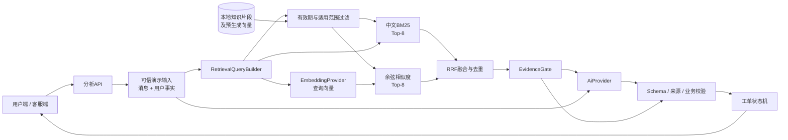

# 客服 Copilot RAG v0.1 技术设计

> 设计日期：2026-10-16
> 状态：阶段A～E的本地实现、30题正式检索评估、EvidenceGate修复、开发检查与独立QA已完成；提交和发布待完成
> 目标：把当前“固定来源输入”升级为可运行、可评估、可追溯的轻量混合检索 RAG，同时保留既有分类、流转、人工操作边界与演示稳定性。

## 1. 决策摘要

RAG v0.1 采用以下受控范围：

- 在 Next.js 服务端运行本地知识检索，不引入数据库或独立向量数据库。
- 知识库由 6～10 份业务文档、约 30～50 个原子知识片段组成，包含有效版本、过期版本和干扰片段。
- 同时运行中文 BM25 关键词检索和 Embedding 语义检索，以 RRF 合并排名，最终向生成模型提供 Top-3 片段。
- 文档向量离线生成并随版本化索引保存；用户问题在运行时生成查询向量，文档和查询必须使用同一 Embedding 模型及维度。
- DeepSeek继续负责工单候选分析和回复生成，不假设其生成接口同时提供 Embedding；Embedding使用独立Provider接口。
- Mock、DeepSeek和Gemini生成模式共用同一套检索结果。Mock Mode不调用外部生成模型，但仍执行真实检索。
- 用户会员、续订、支付、发券等记录不进入知识库或向量索引，继续作为可信业务数据单独查询并传入AI。
- 现有固定演示案例ID和公开接口限制保留，不开放任意公共问答接口。
- 建立独立RAG评估集，对BM25、向量和混合检索分别运行；结果按真实数值记录，不预填成绩。

### 1.1 v0.1包含

1. 版本化知识文档和片段。
2. 中文BM25检索。
3. Embedding向量检索。
4. RRF排名融合。
5. 元数据过滤和冲突检测。
6. Top-K检索轨迹及引用来源。
7. 证据不足、冲突或检索失败时的受控转人工。
8. 固定RAG评估集、指标计算和对比报告。
9. 三条现有演示旅程接入运行时检索。

### 1.2 v0.1不包含

- 文档上传和知识管理后台。
- 生产数据库、向量数据库或外部搜索集群。
- 自动解析PDF、Word或网页。
- 自动切片、自动发布、审批流和知识运营权限。
- 用户画像、历史咨询画像或真实个人数据入库。
- 对公众开放的任意问题输入接口。
- Reranker、Agent自主工具调用或多轮自主检索。
- 用Ragas自动分数替代人工业务验收。

## 2. 当前实现与缺口

当前 `/api/ai/analyze` 根据四个固定案例ID选择 `AiAnalysisInput`。每个演示输入已经携带固定的 `knowledge_sources`；Provider只消费这些已准备好的来源，不会在请求发生时查询知识库。

现有能力可直接复用：

- `AiProvider`、DeepSeek、Gemini和Mock生成路径。
- AI结构化输出Schema与AJV校验。
- 来源白名单校验和业务规则校验器。
- 低风险、低风险其他类和高风险的确定性流转规则。
- 证据不足或冲突时禁止直接回复的业务边界。
- 工单详情中的知识依据、引用片段和审计展示。
- 32条分类与流转验收基线。

需要新增或调整：

- 从演示数据中移除固定知识正文，只保留问题、可信用户事实和用户数据来源。
- 在Provider调用前增加运行时 `RagService`。
- 以片段ID而不是仅以文档ID校验模型引用。
- 保存检索模式、排名、分数、索引版本和耗时等检索轨迹。
- 新建独立RAG评估集；现有32条分类测试继续负责业务分类与路由，不承担检索评估。

## 3. 总体架构



### 3.1 运行顺序

1. API仍只接受已定义的演示案例ID。
2. 服务端从演示数据取得用户消息、身份状态、可信用户事实和用户数据来源。
3. `RetrievalQueryBuilder`提取本轮完整问题；案例二追加诉求时组合前后两轮，但不加入UID、交易号等无助于知识检索的字段。
4. 知识仓库先执行硬元数据过滤：文档状态、有效期、可见角色、语言及明确产品适用范围。
5. 在同一候选集合上并行执行中文BM25和向量检索，各取Top-8。
6. RRF根据两份排名计算融合排序，执行重复片段合并和文档多样性限制，取最终Top-3。
7. `EvidenceGate`判断 `available`、`insufficient` 或 `conflicting`，并生成检索轨迹。
8. 将Top-3映射为AI可引用的知识来源，与用户事实分别传给当前生成Provider。
9. Provider只能返回输入中存在的片段ID；本地重新装配完整来源对象。
10. Schema、来源白名单、EvidenceGate和业务规则共同决定候选结果是否可以进入工单状态机。

### 3.2 安全优先级

检索结果不能覆盖确定性业务规则：

- 出现退款、举报、账户安全、法律或安全诉求时，即使检索失败，也必须进入二线。
- 用户明确要求退订、补发、投诉或建议时，即使知识充分，仍必须进入一线，AI不得自动执行。
- 个人记录查询未完成身份校验时，不得因知识片段充分而直接回复个人状态。
- EvidenceGate给出 `insufficient` 或 `conflicting` 后，生成模型不得将证据状态升级为充分。
- 生成模型引用不存在的片段ID时拒绝应用结果。

## 4. 模块与目录规划

```text
src/
  rag/
    types.ts                     # RAG内部类型
    knowledge-repository.ts      # 加载、校验文档和片段
    retrieval-query-builder.ts   # 构造检索查询，去除无关标识符
    metadata-filter.ts           # 有效期、状态、产品、角色过滤
    bm25-retriever.ts            # 中文BM25候选召回
    embedding-provider.ts        # EmbeddingProvider接口
    vector-retriever.ts          # 余弦相似度候选召回
    reciprocal-rank-fusion.ts    # RRF合并
    evidence-gate.ts             # 无证据、低相关和冲突保护
    rag-service.ts               # 对API暴露统一retrieve方法
  data/
    knowledge/
      manifest.json              # 知识库版本与索引信息
      documents/*.json           # 文档级元数据
      chunks/*.json              # 可检索原子片段
      index/embeddings-v0.1.json # 预生成文档向量
scripts/
  build-knowledge-index.ts       # 校验知识并生成文档向量索引
  evaluate-rag.ts                # 运行三种检索模式并生成报告
tests/
  fixtures/
    rag-evaluation-v0.1.jsonl    # RAG评估主数据
  unit/rag/
  evaluation/
reports/
  rag-evaluation-v0.1.json
  rag-evaluation-v0.1.md
```

说明：目录是RAG v0.1整体目标。截至2026-10-22已完成知识文档/片段、manifest构建、知识仓库校验、中文Tokenizer、元数据过滤、BM25、SiliconFlow Embedding Provider、33条版本化向量索引、余弦向量检索、RRF融合、统一检索入口、运行时Hybrid、EvidenceGate、片段ID引用、客服端检索轨迹，以及30题正式三模式检索评估与人工回答评分框架。生成回答尚未批量调用DeepSeek或完成人工评分。

## 5. Embedding Provider边界

```ts
interface EmbeddingProvider {
  readonly providerName: string;
  readonly model: string;
  readonly dimensions: number;
  embedQuery(text: string): Promise<number[]>;
  embedDocuments(texts: string[]): Promise<number[][]>;
}
```

### 5.1 必须满足的条件

- 支持中文语义表示。
- 查询和文档使用同一模型、同一维度和同一归一化方式。
- 可在当前网络和Vercel服务端访问。
- 密钥只保存在服务端环境变量。
- 返回向量维度、数量或数值非法时立即失败，不能静默伪造向量。
- 索引记录模型名、维度和文本哈希；模型或文本变化后必须重建索引。

### 5.2 首选Provider与验证状态

当前DeepSeek配置用于生成，不能假设同一API Key和端点支持Embedding。Gemini内容生成曾受地区限制，也不能未经实测作为v0.1默认Embedding路径。

v0.1首选 **SiliconFlow `BAAI/bge-m3`**：

- 接口：`POST https://api.siliconflow.cn/v1/embeddings`
- 环境变量：`SILICONFLOW_API_KEY`
- 模型变量：`EMBEDDING_MODEL=BAAI/bge-m3`
- 模型输出维度：1024
- 最大输入：8192 tokens
- 支持字符串或字符串数组批量输入
- 截至2026-10-21，SiliconFlow官方价格页将非Pro `BAAI/bge-m3`标为免费；实际可用性和价格仍以调用时官方页面为准

备选为阿里云百炼 `text-embedding-v4`。它支持中文及100多种语言、多个输出维度，费用约为每千输入Token 0.0005元量级；如果SiliconFlow在本机或Vercel不可用，再对百炼进行真实冒烟。

截至2026-10-21，本机真实Provider冒烟已通过：使用 `BAAI/bge-m3` 对5条虚构中文客服文本执行一次批量请求，返回HTTP 200、5个1024维向量，共93个输入Token，单次请求耗时345ms。取消续订问题与对应规则的余弦相似度为0.7879，高于优惠券规则0.5724和退款规则0.5632；优惠券问题与对应规则为0.8419，高于续订规则0.5427。该结果证明当前密钥、网络、模型维度和基础中文语义排序可用，但单次耗时与少量样本不能替代正式P50/P95及30条评估集。

代码保持Provider无关，至少实现：

- `FakeEmbeddingProvider`：仅用于单元测试，输出固定向量，不作为作品演示结果。
- `SiliconFlowEmbeddingProvider`：用于索引构建、运行时查询和评估。

如果真实Embedding Provider未配置：

- 系统可以明确降级到 `bm25` 模式；
- 页面和评估报告必须显示实际检索模式；
- 不得显示“混合检索”或把BM25结果冒充为Embedding结果。

## 6. 中文BM25方案

v0.1建议使用本地TypeScript搜索引擎实现BM25，并配置专用中文Tokenizer。候选为 `@orama/orama` 配合 `@orama/tokenizers`；正式实施前需用本项目语料做最小验证并锁定确切版本。

索引字段及权重建议：

| 字段 | 是否检索 | 初始权重 | 说明 |
|---|---:|---:|---|
| `title` | 是 | 2.0 | 文档主题 |
| `section_path` | 是 | 1.5 | 章节语义 |
| `text` | 是 | 1.0 | 规则正文 |
| `keywords` | 是 | 1.4 | 业务术语与明确同义表达 |
| 其他元数据 | 否 | - | 只用于过滤和审计 |

`keywords`只能保存可解释的业务同义词，例如“续费/自动扣费”“福利/优惠券”，不能为评估题逐条抄入答案词。

## 7. 向量检索与RRF

### 7.1 文档向量

- 文档片段向量由 `build-knowledge-index.ts` 离线生成。
- 向量文件随知识库版本提交，但不得包含用户数据、API Key或请求日志。
- 片段检索文本统一为：`标题 + 章节路径 + 正文`；关键词是否进入Embedding文本需要通过评估决定，默认不加入。
- 运行时仅为用户问题生成查询向量，然后计算与候选片段的余弦相似度。

### 7.2 候选数量

- BM25候选：Top-8。
- 向量候选：Top-8。
- RRF融合后：Top-3。
- 同一文档默认最多保留2个片段，防止单份长文档挤占全部上下文。

这些数值是v0.1初始配置，不是评估结果；最终值应根据固定评估集调整并记录理由。

### 7.3 RRF计算

对于某个片段 `d`：

```text
rrfScore(d) = Σ 1 / (rrfK + rank_i(d))
```

- `rank_i(d)` 是片段在BM25或向量结果中的名次，从1开始。
- `rrfK`初始使用60。
- 未出现在某一路结果中的片段，该路不计分。

RRF使用排名而不是直接相加BM25分数与余弦相似度，因为两种原始分数不在同一尺度。

系统同时保留以下分数用于诊断：

- `lexical_score`
- `vector_score`
- `lexical_rank`
- `vector_rank`
- `rrf_score`
- `final_rank`

这些分数默认只在客服端调试或评估报告中展示，不向用户端暴露。

## 8. 元数据过滤设计

### 8.1 硬过滤

硬过滤在检索前执行，过滤掉明确不允许使用的片段：

- `status = active`
- `effective_from <= query_time`
- `effective_to`为空或晚于查询时间
- `language = zh-CN`
- `audiences`包含当前使用场景，例如 `ai`、`tier1`或`tier2`
- 已知产品类型与 `applicable_products`不冲突

通用政策使用 `applicable_products = ["all"]`，不能因用户产品未知而被错误过滤。

### 8.2 软信号

问题类型在AI分析前尚未最终确定，因此以下字段只能用于提升排名或诊断，不能在第一轮作为硬过滤把结果排除：

- `issue_subtypes`
- `business_domains`
- 从用户语言推测的产品类型
- 从关键词推测的风险类别

这样可以避免形成“先用未确认分类过滤知识，再用被过滤的知识证明分类”的循环。

## 9. EvidenceGate

检索层输出独立的 `retrieval_status`：

```ts
type RetrievalStatus =
  | "available"
  | "insufficient"
  | "conflicting"
  | "unavailable";
```

### 9.1 判定规则

- `unavailable`：Embedding服务故障且所选模式不允许降级，或知识索引损坏。
- `insufficient`：没有有效候选，所有候选均低于基础相关阈值，或候选只覆盖业务主题但未覆盖问题的具体语义。
- `conflicting`：同一 `rule_key` 下存在同时有效、适用范围相同但 `decision_value`相反的片段，且无法按优先级或替代关系消解。
- `available`：至少存在通过过滤和基础相关度门槛的可用片段，并满足查询重点短语覆盖、强向量证据或强关键词证据中的一项，且未发现未消解冲突。

RRF分数本身只代表融合排名，不直接当作证据充分度。2026-10-22基于固定30题评估集校准的v0.1门槛为：基础Vector 0.55或BM25 1.5；在提供原始问题时，还需满足查询与Top-3证据重点短语覆盖率0.21、强Vector 0.67或强BM25 20中的任一项。该组合用于拦截“主题相似但没有回答具体问题”的片段，不能替代后续更大规模评估或跨编码Reranker。

### 9.2 与现有 `evidence_status` 的关系

| RetrievalStatus | AI可输出的最高证据状态 | 允许动作 |
|---|---|---|
| `available` | `sufficient` | 仍需满足身份、风险和业务规则 |
| `insufficient` | `insufficient` | 追问或转一线/二线 |
| `conflicting` | `conflicting` | 转人工确认有效规则 |
| `unavailable` | `insufficient` | 明确失败并走安全人工路径 |

Provider可以把 `available`进一步判断为 `insufficient`，但不能反向升级其他状态。

## 10. 知识库结构

知识库分为文档和片段两层。文档负责版本、发布和适用范围；片段负责检索、引用和评估。

### 10.1 KnowledgeDocument

```ts
interface KnowledgeDocument {
  document_id: string;
  title: string;
  version: string;
  status: "draft" | "active" | "retired";
  language: "zh-CN";
  effective_from: string;
  effective_to: string | null;
  supersedes_document_id: string | null;
  business_domains: string[];
  applicable_products: string[];
  audiences: Array<"ai" | "tier1" | "tier2">;
  source_owner: string;
  updated_at: string;
}
```

示例：

```json
{
  "document_id": "KB-MEMBER-001",
  "title": "会员自动续订与退订规则",
  "version": "2026.09",
  "status": "active",
  "language": "zh-CN",
  "effective_from": "2026-09-01T00:00:00+08:00",
  "effective_to": null,
  "supersedes_document_id": "KB-MEMBER-001-OLD",
  "business_domains": ["membership", "renewal"],
  "applicable_products": ["all"],
  "audiences": ["ai", "tier1", "tier2"],
  "source_owner": "会员业务部",
  "updated_at": "2026-09-01T00:00:00+08:00"
}
```

### 10.2 KnowledgeChunk

```ts
interface KnowledgeChunk {
  chunk_id: string;
  document_id: string;
  section_path: string[];
  text: string;
  keywords: string[];
  issue_subtypes: string[];
  rule_key: string;
  decision_value: string | null;
  priority: number;
  checksum: string;
}
```

示例：

```json
{
  "chunk_id": "KB-MEMBER-001#cancel-current-entitlement",
  "document_id": "KB-MEMBER-001",
  "section_path": ["取消自动续订", "当前周期权益"],
  "text": "取消自动续订只停止下一周期续费，不会提前终止当前已支付周期内的会员权益。",
  "keywords": ["取消续订", "关闭连续包月", "会员仍有效", "下期扣费"],
  "issue_subtypes": ["renewal_query", "membership_query", "unsubscribe"],
  "rule_key": "renewal.cancel.current_entitlement",
  "decision_value": "entitlement_remains_until_expiry",
  "priority": 100,
  "checksum": "sha256:<由构建脚本生成>"
}
```

### 10.3 切片规则

- 采用人工整理的语义原子片段，不按固定字符数机械切割。
- 一个片段只表达一项可以独立引用的规则或处理边界。
- 建议正文约80～300个中文字符；过短时与必要条件合并，过长时按规则条件拆分。
- 标题和章节路径不重复写入正文，但检索时拼接。
- 条件、例外和结论不能被拆到不同片段导致语义残缺。
- 旧版本保留用于元数据过滤测试，但必须标记 `retired` 或结束有效期。
- 冲突测试使用专门Fixture，不在生产演示知识库中故意保留无法消解的正式冲突。

### 10.4 KnowledgeManifest

`manifest.json`定义一次可复现的知识发布：

```ts
interface KnowledgeManifest {
  knowledge_base_version: string;
  built_at: string;
  document_ids: string[];
  chunk_count: number;
  content_checksum: string;
  embedding: {
    provider: string;
    model: string;
    dimensions: number;
    normalized: boolean;
    index_file: string;
  } | null;
}
```

加载知识库时必须验证：

- 文档ID和片段ID唯一；
- 每个片段都能找到所属文档；
- `chunk_count`与实际数量一致；
- `content_checksum`与当前文档、片段内容一致；
- Hybrid/Vector模式下Embedding模型、维度和索引文件一致。

任何一项不一致均视为索引不可用，不能继续使用旧向量。

### 10.5 Embedding索引

```ts
interface EmbeddingIndex {
  knowledge_base_version: string;
  provider: string;
  model: string;
  dimensions: number;
  normalized: boolean;
  entries: Array<{
    chunk_id: string;
    text_checksum: string;
    vector: number[];
  }>;
}
```

- 一个片段必须且只能有一个向量条目。
- `text_checksum`必须与片段当前检索文本一致。
- 向量必须全部为有限数值且长度等于 `dimensions`。
- 文档或Embedding模型发生变化时必须完整重建索引；v0.1不实现增量索引。

### 10.6 v0.1知识主题

| 文档 | 主要内容 | 预计片段数 |
|---|---|---:|
| `KB-MEMBER-001` | 取消续订、当前权益、下期扣费 | 4～5 |
| `KB-MEMBER-002` | 会员状态、到期时间、身份校验 | 3～4 |
| `KB-BENEFIT-003` | 活动产品资格、赠券条件、发放时间 | 4～5 |
| `KB-BENEFIT-004` | 资格争议和一次性非现金补偿 | 4～5 |
| `KB-OPERATION-005` | 退订、补发和状态查询的人工边界 | 4～5 |
| `KB-COMPLAINT-006` | 投诉建议登记和部门通知 | 3～4 |
| `KB-REFUND-007` | 扣费争议、退款权限和支付核查 | 4～5 |
| `KB-SECURITY-008` | 举报、账户安全、法律安全升级 | 3～4 |
| 过期/干扰文档 | 旧活动、相似但不适用产品规则 | 4～8 |

首版已整理10份文档和33个原子片段，其中包含1份已退役规则及2个干扰片段。数量是范围控制，不作为质量指标；后续应根据正式评估缺口补充知识，而不是为达到数量机械拆分。

### 10.7 知识元数据与个人订购信息的边界

`issue_subtypes`、`rule_key`和`decision_value`属于知识规则元数据，不代表某个用户的实际状态：

- `issue_subtypes`表示该知识片段可支持哪些问题类型，例如续订查询、会员查询或退订操作说明。
- `rule_key`是业务规则的稳定标识，用于版本替代和冲突检测。
- `decision_value`是规则结论的标准化表达，例如“权益持续到当前周期结束”。

个人订购信息继续只存在于可信 `user_facts`和 `user_data_sources`中，例如当前会员状态、自动续订状态、权益到期时间，以及用户自己的订单、支付或发券记录。

UID、订单号、交易号和某个用户的订购状态不得进入知识文档、知识片段或Embedding索引。最终回答可以组合“检索到的通用规则”和“经过身份校验的用户事实”，但两类来源必须分别标注。

## 11. 检索类型与返回结构

```ts
type RetrievalMode = "bm25" | "vector" | "hybrid";

interface RetrievalQuery {
  text: string;
  query_time: string;
  audience: "ai" | "tier1" | "tier2";
  known_product_type: string | null;
  language: "zh-CN";
}

interface RetrievalHit {
  chunk: KnowledgeChunk;
  document: KnowledgeDocument;
  lexical_score: number | null;
  vector_score: number | null;
  lexical_rank: number | null;
  vector_rank: number | null;
  rrf_score: number | null;
  final_rank: number;
}

interface RetrievalResult {
  mode_requested: RetrievalMode;
  mode_used: RetrievalMode;
  status: RetrievalStatus;
  knowledge_base_version: string;
  embedding_model: string | null;
  hits: RetrievalHit[];
  filtered_count: number;
  timings_ms: {
    metadata_filter: number;
    lexical: number | null;
    embedding: number | null;
    vector: number | null;
    fusion: number | null;
    total: number;
  };
  warning: string | null;
}
```

### 11.1 运行配置与降级

建议配置：

```text
RAG_RETRIEVAL_MODE=hybrid
RAG_ALLOW_LEXICAL_FALLBACK=true
EMBEDDING_PROVIDER=siliconflow
EMBEDDING_MODEL=BAAI/bge-m3
SILICONFLOW_API_KEY=<server-only secret>
```

- `bm25`不调用Embedding服务。
- `vector`要求查询Embedding成功，不自动转为BM25。
- `hybrid`要求两路都成功；只有显式开启 `RAG_ALLOW_LEXICAL_FALLBACK` 时，Embedding失败才允许使用BM25继续。
- 发生回退时 `mode_requested`仍为 `hybrid`，`mode_used`必须写成 `bm25`，并返回非空 `warning`。
- 页面、日志和评估报告必须使用 `mode_used`描述实际结果。
- 正式对比评估一律关闭回退；否则该次结果无效。

同一浏览器会话可按“知识库版本 + Embedding模型 + 查询文本哈希”缓存查询向量和检索结果以减少重复费用，但Vercel实例内存缓存只作为优化，不能依赖它保证正确性或持久性。

## 12. 与现有AI接口的集成

### 12.1 `AiAnalysisInput`

目标状态：

```ts
interface AiAnalysisInput {
  message: string;
  identity_status: "verified" | "unverified" | "not_required";
  user_facts: Record<string, string | number | boolean | null>;
  retrieved_knowledge: RetrievedKnowledgeSource[];
  retrieval_status: RetrievalStatus;
  knowledge_base_version: string;
  user_data_sources: UserDataSource[];
}
```

`RetrievedKnowledgeSource`由 `RetrievalHit`裁剪而来，提供：

- `chunk_id`
- `document_id`
- `title`
- `section`
- `version`
- `quote`

分数和内部过滤信息不进入生成Prompt，避免模型把分数解释成业务事实；它们留在检索轨迹中。

### 12.2 引用校验

当前模型返回 `knowledge_source_ids`并按文档ID校验。v0.1改为返回 `knowledge_chunk_ids`：

- 只能引用本次Top-K中的片段ID。
- 一个回答中的关键事实必须能对应至少一个被引用片段。
- 完整来源仍由服务端从可信知识仓库重新装配。
- 文档ID、标题、版本和引用正文不得由模型自由生成。

### 12.3 Ticket兼容

当前Ticket Schema中的 `knowledge_sources`已经能保存文档、章节、版本和引用正文。v0.1暂不要求把BM25分数、向量分数或RRF分数写进正式工单；检索轨迹保存在演示会话/API诊断数据和评估报告中。

为避免立刻升级整个Ticket Schema：

- `chunk_id`作为应用内部引用主键；
- 写入Ticket时继续映射到现有 `knowledge_sources`结构；
- `knowledge_base_version`写入现有审计字段；
- 如果后续需要跨会话复现每次排名，再单独设计Ticket Schema v0.2的 `retrieval_trace`。

## 13. Mock Mode与AI Mode

| 环节 | Mock Mode | AI Mode |
|---|---|---|
| 元数据过滤 | 真实执行 | 真实执行 |
| BM25 | 真实执行 | 真实执行 |
| 查询Embedding | 按选定检索模式真实执行 | 按选定检索模式真实执行 |
| 向量检索与RRF | 真实执行 | 真实执行 |
| 工单生成 | `MockAiProvider` | DeepSeek或备用Provider |
| 外部生成模型调用 | 无 | 有 |

这样能够把“检索是否正确”和“生成模型是否稳定”分开测试。Mock结果不得继续引用硬编码知识；它必须只使用本次检索实际返回的Top-K来源。

公开网站中，Mock Mode和AI Mode默认都请求完整Hybrid检索。Mock只替代最终生成环节，不替代Embedding或检索。若Embedding请求失败：

- 在已开启 `RAG_ALLOW_LEXICAL_FALLBACK`时明确降级为BM25；
- `mode_used`必须记录为 `bm25`并显示低权重警告；
- 不得继续显示Hybrid；
- 正式评估禁止回退。

### 13.1 客服端检索轨迹

客服端增加默认折叠、低视觉权重的“查看检索轨迹”入口，放在AI处理信息或知识来源附近。用户端不显示内部检索信息。

展开后至少显示：

- 请求模式与实际模式；
- 知识库版本和Embedding模型；
- Top-K片段ID、标题和最终排名；
- 每个片段的BM25排名、Vector排名与RRF分数；
- 元数据过滤数量；
- 检索总耗时与Embedding耗时；
- 是否发生降级及原因。

入口用于作品讲解、故障排查和评估复核，不应抢占AI摘要、原始录音和人工操作的主要层级。

## 14. 评估数据格式

### 14.1 主格式选择

机器可读主格式使用JSONL，每行一个完整评估案例。原因：

- 正确片段可能有多个；
- 必需事实和禁止事实都是数组；
- 元数据条件是嵌套对象；
- CSV中嵌套JSON容易出现转义和人工编辑错误。

评估脚本另行输出Markdown汇总表，供作品集和简历取用。现有分类与流转CSV保持不变。

### 14.2 字段定义

```ts
interface RagEvaluationCase {
  eval_id: string;
  query: string;
  conversation_context: string[];
  query_time: string;
  audience: "ai" | "tier1" | "tier2";
  known_product_type: string | null;
  identity_status: "verified" | "unverified" | "not_required";
  answerability: "answerable" | "unanswerable" | "conflicting";
  relevant_chunk_ids: string[];
  acceptable_chunk_ids: string[];
  reference_answer: string | null;
  required_claims: string[];
  forbidden_claims: string[];
  expected_citation_chunk_ids: string[];
  expected_route: "ai" | "tier1" | "tier2";
  tags: string[];
  notes: string;
}
```

字段解释：

- `relevant_chunk_ids`：完整回答不可缺少的正确依据，用于Recall@K。
- `acceptable_chunk_ids`：不是必需，但属于相关内容，用于Precision和人工分析。
- `required_claims`：最终回答必须覆盖的事实。
- `forbidden_claims`：不得出现的承诺或错误，例如“已退款”“普通月卡符合原赠券资格”。
- `expected_citation_chunk_ids`：回答引用可以接受的片段集合。
- `answerability`：知识库是否足以回答，不与风险路由混为一谈。
- `expected_route`：即使知识充分，退款等高风险仍应转二线。

### 14.3 示例：可回答

```json
{"eval_id":"RAG-001","query":"我已经把连续包月关掉了，怎么会员还没失效？","conversation_context":[],"query_time":"2026-10-16T10:00:00+08:00","known_product_type":"continuous_monthly","identity_status":"verified","answerability":"answerable","relevant_chunk_ids":["KB-MEMBER-001#cancel-current-entitlement"],"acceptable_chunk_ids":["KB-MEMBER-001#cancel-next-charge"],"reference_answer":"取消自动续订不会提前终止已支付周期内的会员权益，权益会持续至到期时间。","required_claims":["取消续订只停止下一周期续费","当前已支付周期权益仍有效"],"forbidden_claims":["已为用户执行退订","会员会立即失效"],"expected_citation_chunk_ids":["KB-MEMBER-001#cancel-current-entitlement"],"expected_route":"ai","tags":["paraphrase","renewal","membership"],"notes":"验证‘关掉连续包月’与‘取消自动续订’的语义匹配"}
```

### 14.4 示例：无法回答

```json
{"eval_id":"RAG-024","query":"这张优惠券能不能转给朋友？","conversation_context":[],"query_time":"2026-10-16T10:00:00+08:00","known_product_type":null,"identity_status":"not_required","answerability":"unanswerable","relevant_chunk_ids":[],"acceptable_chunk_ids":[],"reference_answer":null,"required_claims":[],"forbidden_claims":["优惠券可以转赠","优惠券禁止转赠"],"expected_citation_chunk_ids":[],"expected_route":"tier1","tags":["knowledge-gap","abstention"],"notes":"知识库未定义转赠规则，必须拒绝猜测并转人工"}
```

### 14.5 示例：版本过滤

```json
{"eval_id":"RAG-025","query":"普通月卡参加现在的50元赠券活动吗？","conversation_context":[],"query_time":"2026-10-16T10:00:00+08:00","known_product_type":"ordinary_monthly_card","identity_status":"not_required","answerability":"answerable","relevant_chunk_ids":["KB-BENEFIT-003#eligible-products-current"],"acceptable_chunk_ids":[],"reference_answer":"当前活动仅面向连续包月产品，普通月卡不符合原活动赠券资格。","required_claims":["仅连续包月符合当前活动资格","普通月卡不符合原活动资格"],"forbidden_claims":["普通月卡符合活动资格","投诉后自动获得原活动资格"],"expected_citation_chunk_ids":["KB-BENEFIT-003#eligible-products-current"],"expected_route":"ai","tags":["metadata-filter","retired-document","product-scope"],"notes":"知识库中另有已过期的普通月卡活动规则，必须被有效期过滤"}
```

### 14.6 人工评估结果格式

人工评分写入单独的结果文件，不回写Gold评估集：

```ts
interface RagHumanEvaluationResult {
  eval_id: string;
  retrieval_mode_used: "bm25" | "vector" | "hybrid";
  answer_correctness_score: 0 | 1 | 2;
  has_critical_error: boolean;
  critical_error_types: Array<
    | "forbidden_claim"
    | "policy_violation"
    | "unsafe_action"
    | "wrong_route"
  >;
  reviewer_note: string;
  reviewed_at: string;
}
```

v0.1不为人工评分单独开发产品前端。评审人员在评估结果中填写分数，脚本生成Markdown汇总报告。

## 15. 评估集组成

首版已建立30条固定评估案例，覆盖下列能力维度。部分案例同时属于多个维度，因此下表不是互斥计数：

| 类型 | 数量 | 目的 |
|---|---:|---|
| 精确业务词查询 | 6 | 验证BM25基础召回 |
| 口语改写/低字面重合 | 6 | 验证Embedding与混合检索增益 |
| 多条件组合问题 | 4 | 验证多个相关片段召回 |
| 产品范围/有效期陷阱 | 4 | 验证元数据过滤 |
| 相似干扰规则 | 3 | 验证排序精度 |
| 知识缺口 | 3 | 验证拒答和转人工 |
| 冲突Fixture | 2 | 验证冲突检测 |
| 高风险但知识可检索 | 2 | 验证RAG不覆盖二线路由 |

评估问题不得全部直接复制知识原文；至少三分之一使用真实口语改写，且由人工标注正确片段。

## 16. 指标定义

### 16.1 检索指标

**Recall@3**

```text
进入Top-3的必需正确片段数 / 全部必需正确片段数
```

用于判断回答所需依据有没有被找回来。

**MRR**

```text
每个问题第一个正确片段排名倒数的平均值
```

正确片段排第1得1，排第2得0.5。无正确片段得0。

**Precision@3**

```text
Top-3中相关片段数 / 实际返回片段数
```

用于检查是否把大量无关内容交给生成模型。

v0.1不强制使用nDCG；只有以后为片段标注多级相关度时再加入。

### 16.2 生成和引用指标

- `Citation Precision`：被引用片段中真正支持回答事实的比例。
- `Citation Recall`：回答中的关键事实有引用支持的比例。
- `Faithfulness`：逐条拆分回答事实，检查能否由检索片段或可信用户事实推出。
- `Answer Correctness`：依据参考答案和业务规则人工评分，使用0/1/2三级：
  - `0`：核心结论错误，或回答没有解决问题。
  - `1`：核心方向基本正确，但遗漏关键事实、适用条件或重要限制。
  - `2`：覆盖全部必需事实，没有错误或禁止事实，表达清楚。
- `Critical Error`：独立记录禁止承诺、业务规则违规、不安全操作或错误流转，避免把严重错误与普通答案质量混在同一分值中。
- `Forbidden Claim Rate`：出现禁止承诺或错误事实的案例比例，目标必须为0。

Ragas可以作为辅助计算工具，但涉及业务规则、引用和转派的结果必须人工复核；自动评分不能替代固定规则测试。

Answer Correctness报告同时提供：

- 平均原始分，以 `x.xx / 2.00` 展示；
- 完全正确率，即得2分的案例占比；
- 错误率，即得0分的案例占比；
- 严重错误率，即 `has_critical_error=true` 的案例占比，目标必须为0；
- 如需百分制，使用 `平均原始分 / 2 × 100%`，并与原始分同时展示，例如 `1.72 / 2.00（86%）`。

### 16.3 拒答和流转指标

- `Abstention/Handoff Accuracy`：不可回答或冲突案例是否正确拒答/转人工。
- `Route Accuracy`：是否进入AI、一线或二线预期路径。
- 高风险案例二线召回率：所有高风险案例必须为100%，不因检索充分而降级。

### 16.4 性能与成本

分别记录：

- 纯检索延迟P50/P95。
- 查询Embedding延迟P50/P95。
- 端到端生成延迟P50/P95。
- 单次查询Embedding费用。
- 单次生成费用。

Mock模式不计生成模型费用，但Embedding若使用外部服务仍需单独计费。

## 17. 对比实验

固定同一知识库、同一评估集和同一Top-K，运行：

1. `bm25`
2. `vector`
3. `hybrid`

2026-10-22使用30条固定评估集完成一次正式检索对比。28条可回答案例用于Recall@3和MRR；Precision@3与EvidenceGate可回答性准确率统计全部30条。Vector和Hybrid使用同一次真实SiliconFlow `BAAI/bge-m3`查询向量批处理，禁用词法降级。

| 方案 | Recall@3 | MRR | Precision@3 | EvidenceGate准确率 | 检索P50/P95(ms) | Embedding P50/P95(ms) |
|---|---:|---:|---:|---:|---:|---:|
| BM25 | 0.8750 | 0.9048 | 0.4444 | 1.0000 | 0.21 / 0.51 | — |
| Vector | 0.9107 | 0.8750 | 0.4667 | 0.9667 | 16.60 / 16.76 | 16.45 / 16.45 |
| Hybrid | 0.9286 | 0.9048 | 0.4667 | 1.0000 | 16.76 / 16.92 | 16.45 / 16.45 |

本次Hybrid取得最高Recall@3，并保持与BM25相同的MRR；Vector和Hybrid的Precision@3相同。两条知识缺口在三种模式下都被EvidenceGate正确判为不足。Vector单路对RAG-017返回不足，因为其Top-3未召回正确的历史补发状态片段；这是安全拒答，运行时Hybrid已召回相关片段并正确放行。延迟仅为本次本机观测值。完整排名保存在 `reports/rag-formal-retrieval-comparison-v0.1.md` 和JSON报告中。生成回答、引用正确性、Faithfulness和Answer Correctness尚未运行或评分，不能从本表推断。

不能预设混合检索一定获胜。如果混合检索没有改善，需保留结果并分析中文分词、Embedding模型、语料规模、元数据过滤或RRF参数，而不是修改评估答案迎合方案。

## 18. 验收标准

### 18.1 功能

- 三个现有案例的知识来源必须由运行时检索产生，不再由演示数据直接携带。
- Mock和AI模式引用同一批实际Top-K片段。
- 客服端能看到知识标题、版本、引用正文及片段来源；用户端不显示内部排名和分数。
- 无知识、冲突和检索故障路径不会生成无依据的直接答复。
- 模型引用Top-K之外的片段时拒绝应用。
- 旧版本和不适用产品的规则不会进入最终Top-K。
- 高风险和写操作的现有人工边界保持不变。

### 18.2 测试

- 现有32条分类与流转基线全部继续通过。
- 现有三条浏览器旅程无回归。
- 知识Schema、重复ID、孤立片段、版本、时间和向量维度均有自动校验。
- RRF、过滤、冲突检测、降级和引用白名单有确定性单元测试。
- 30条RAG评估案例全部运行并生成未篡改的结果报告。
- 高风险二线路由、禁止事实和无依据直接回复的安全检查必须全部通过。

### 18.3 指标使用原则

v0.1先运行基线再确定最终优化目标，不把目标值写成已实现结果。至少要求：

- 混合检索在口语改写子集上不得低于BM25 Recall@3；否则不能宣称混合检索带来提升。
- 所有可回答案例的引用必须来自实际Top-K。
- 知识缺口与冲突案例不得直接给出确定答案。
- 任何简历数字必须来自保存的评估报告。

## 19. 测试职责分离

实施者负责：

- 知识Schema、检索器、融合、EvidenceGate和API集成。
- 针对性单元测试、类型检查、Lint、构建和本地评估运行。
- 修复独立测试发现的问题。

独立 `qa_tester`负责：

- 核对知识来源是否确由运行时检索产生。
- 验证BM25、Vector、Hybrid三种模式及降级标识。
- 抽查评估集Gold片段和引用正确性。
- 验证无答案、冲突、Embedding失败及高风险路径。
- 复测三条原有用户旅程和桌面/窄屏展示。
- 只报告缺陷，不修改产品代码。

未完成独立QA及缺陷复测前，不得宣称RAG v0.1完成。

## 20. 分阶段实施顺序

### 阶段A：知识契约与语料

1. 建立文档、片段及Manifest Schema。
2. 整理6～10份文档和约34～45个片段。
3. 加入过期版本、相似干扰项和测试冲突Fixture。
4. 完成知识校验测试。

### 阶段B：BM25基线

1. 验证并锁定中文Tokenizer与搜索依赖。
2. 实现元数据过滤、BM25和Top-K。
3. 创建30条人工标注RAG评估集。
4. 运行并保存BM25基线结果。

### 阶段C：Embedding与混合检索

1. 选择并验证可用的中文Embedding Provider。
2. 生成版本化文档向量。
3. 实现查询向量、余弦相似度和RRF。
4. 运行Vector与Hybrid对比评估。

截至2026-10-21，阶段C已按上述范围实现。版本化索引包含33条 `BAAI/bge-m3` 1024维归一化向量，索引以片段ID和正文校验和绑定，知识内容变化会清空旧索引声明。12题固定集实测结果如下；正式质量结论仍需扩充评估集后再作判断：

| 模式 | Recall@3 | MRR |
|---|---:|---:|
| BM25 | 0.9583 | 0.9583 |
| Vector | 0.9167 | 0.8750 |
| Hybrid | 1.0000 | 0.9167 |

完整片段排名和本次运行耗时见 `reports/rag-retrieval-comparison-v0.1.md`。正式对比禁用词法降级，报告中的Vector和Hybrid均使用真实查询向量。

### 阶段D：现有流程集成

1. 从演示输入移除固定知识来源。
2. API在Provider前调用 `RagService`。
3. Provider改为片段ID引用与白名单校验。
4. Mock和AI模式接入同一检索结果。
5. 客服端补充低权重检索轨迹展示。

截至2026-10-21，阶段D已完成开发实现：Mock与AI模式都先运行同一检索链路；固定知识来源已从演示输入移除；Embedding不可用时只在显式允许后降级为BM25并记录实际模式；EvidenceGate的不足、冲突与不可用状态不能被生成模型升级为依据充分。案例二追加诉求使用当前轮问题、非个人化检索提示和一线权限召回争议补偿依据。开发检查、四条真实运行时Hybrid冒烟及独立QA均已通过。

### 阶段E：回归、报告与发布

1. 完成全部开发检查和评估报告。
2. 委派独立 `qa_tester`测试并修复、复测。
3. 更新README和技术设计中的RAG定位。
4. 根据真实结果撰写简历和作品集，不使用未验证数字。

截至2026-10-22，阶段E中的30题正式检索评估、报告生成和人工评分模板已完成开发运行。EvidenceGate已增加问题重点与证据覆盖校验并按固定评估集校准；BM25与Hybrid门控准确率为1.0000，Vector为0.9667。开发侧完整回归、四条真实Hybrid演示冒烟及独立QA均通过。本阶段没有批量调用DeepSeek，答案生成与人工评分仍为未执行；Git提交、Vercel配置与线上验证尚未执行。
5. 提交GitHub并验证Vercel部署。

## 21. 主要风险与处理

| 风险 | 影响 | 处理方式 |
|---|---|---|
| Embedding服务在当前网络或Vercel不可用 | 混合检索无法运行 | 实施前单独冒烟；明确降级BM25且不冒充Hybrid |
| 中文BM25分词不适合业务短句 | 召回低 | 用评估集验证Tokenizer；保留业务同义词和语义检索 |
| 小语料使所有方案成绩虚高 | 简历说服力弱 | 加入过期版本、相似规则、低字面重合和知识缺口 |
| 元数据过滤依赖未确认分类 | 形成循环论证 | 第一轮只使用确定的时间、状态、角色和可信产品信息硬过滤 |
| RRF参数为小数据过拟合 | 评估失真 | 固定评估集，记录改动原因，不按单题调参 |
| 模型引用文档但未引用具体片段 | 引用不可核验 | 改为片段ID白名单并由服务端装配来源 |
| 外部AI或Embedding产生费用 | 公开演示消耗余额 | Mock仍运行Hybrid；缓存页面会话结果；Embedding失败时明确降级BM25并显示实际模式 |
| 评估模型自评偏差 | 指标失真 | 规则指标优先，生成质量采用人工复核，Ragas仅辅助 |

## 22. 已确认决定与剩余前置条件

已经确认：

1. 接受Embedding服务产生少量独立费用。
2. 公开Vercel的Mock Mode与AI Mode均默认运行完整Hybrid。
3. Embedding失败时允许明确降级BM25，但不能冒充Hybrid。
4. 客服端增加默认折叠的检索轨迹，展示模式、排名、RRF分数和耗时。
5. Answer Correctness采用0/1/2三级人工评分；严重错误通过独立字段和严重错误率记录。

本机Embedding前置验证已完成。上线前仍需在Vercel服务端完成一次连通性冒烟，并确认Secret仅配置在服务端环境变量中。

## 23. 可用于简历的表述边界

实施前只能描述为：

> 设计带来源约束、证据不足转人工的客服RAG流程，并完成可交互的AI工单演示。

完成BM25运行时检索后可以描述为：

> 为客服Copilot实现本地知识检索、版本过滤、Top-K引用和证据不足转人工机制。

完成Embedding、RRF和评估后可以描述为：

> 构建客服混合检索RAG链路，融合中文BM25与语义向量检索，通过版本过滤、片段级引用和证据门控约束生成；建立固定评估集，对比BM25、Vector与Hybrid的检索、引用、转人工和延迟表现。

具体Recall@3、MRR、正确率、延迟和成本必须使用最终报告中的实际数值。

## 24. 技术依据

- [Retrieval-Augmented Generation原始论文](https://arxiv.org/abs/2005.11401)
- [BEIR检索评估论文](https://arxiv.org/abs/2104.08663)
- [Ragas可用指标说明](https://docs.ragas.io/en/latest/concepts/metrics/available_metrics/)
- [Elastic混合检索与RRF说明](https://www.elastic.co/docs/solutions/search/hybrid-search)
- [Orama本地TypeScript搜索引擎](https://docs.orama.com/docs/orama-js)
- [Orama中文Tokenizer说明](https://docs.orama.com/docs/orama-js/supported-languages/using-chinese-with-orama)
- [SiliconFlow Embedding API](https://api-docs.siliconflow.cn/docs/api/embeddings-post)
- [SiliconFlow模型价格](https://siliconflow.cn/pricing)
- [BAAI/bge-m3官方模型卡](https://huggingface.co/BAAI/bge-m3)
- [阿里云百炼文本向量API](https://help.aliyun.com/zh/model-studio/text-embedding-synchronous-api)
