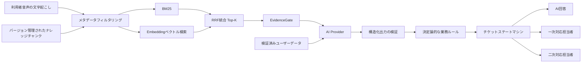

# Customer Service Copilot

インタラクティブなカスタマーサポートRAG／AIチケット処理のデモプロジェクトです。システムは、バージョン管理されたナレッジベースから実行時に根拠を検索し、EvidenceGateで検索結果が回答根拠として利用できるかを判定します。その後、AIが問い合わせ内容を識別して構造化チケットを生成し、リスクと根拠の状態に応じて自動回答または有人対応への引き継ぎを行います。

本プロジェクトでは、既存のカスタマーサポートのチケット処理フローにAIをどのように組み込むかを示すと同時に、決定論的な業務ルールによってAIの権限を制限しています。再発行、解約、返金、通報登録などの操作はすべて担当者による確認が必要であり、AIが実際の業務システムへの更新系操作を直接実行することはありません。

## デモフロー

### AI Only

利用者が、自動更新を解約した後も会員資格が有効な理由を問い合わせます。AIは会員規約と利用者の状態を参照して回答し、利用者が明確に「解決済み」と確認した場合にのみ、チケットを自動完了します。利用者が「未解決・担当者へ引き継ぐ」を選択しただけの場合は、元の分類を維持したまま一次対応担当者へ引き継ぎます。

### Low-Risk AI Assist & Handoff

利用者は最初にクーポンが届いていない理由を問い合わせ、その後、クーポンの再発行とキャンペーン規約に関する苦情を明確に申し出ます。システムは問い合わせを低リスクのその他案件として再分類し、一次対応担当者へ引き継ぎます。担当者が再発行の模擬操作と関係部署への通知を完了した後にのみ、チケットをアーカイブできます。

### High-Risk AI Fast-Track

利用者が、自動更新を解約した後も請求が発生したとして、返金と通報を求めます。システムは最も高いリスクを基準に、チケットを直接二次対応担当者へ引き継ぎます。AIは要約、リスク理由、確認事項の提案のみを行い、返金結果を約束しません。

## 設計原則

- **リスク優先：** 複数の要望が同時に含まれる場合は、最もリスクの高い経路で処理します。
- **根拠の追跡可能性：** AIの回答、分類、提案は、ナレッジ参照元またはユーザーデータ参照元に関連付ける必要があります。
- **更新権限は担当者が保持：** 解約、再発行、返金、利用停止、関係部署への通知をAIが自動実行することはありません。
- **明確な確認後に完了：** 低リスクの情報照会は、利用者が解決を確認した場合にのみ自動完了できます。
- **構造化出力：** AIの出力候補は、JSON Schemaと業務ルールの両方で検証された後にのみチケットへ反映されます。
- **テスト責務の分離：** 開発時のチェックと独立QAを分けて実施します。

## 技術アーキテクチャ



- Next.js 16、React、TypeScript、Tailwind CSS 4
- 33件のバージョン管理されたナレッジチャンク、中国語向けBM25、SiliconFlow `BAAI/bge-m3`ベクトル検索、RRF統合
- EvidenceGate、チャンクID引用の許可リスト、担当者画面で折りたたみ可能な検索トレース
- DeepSeek Responses APIを使用する実AIモード
- 安定したデモと自動テストに使用するMock AI
- Geminiの予備Provider
- AJVによるJSON Schema検証
- Vitest、Testing Library、Playwright

## ローカルでの実行

Node.jsとnpmが必要です。

```bash
npm install
cp .env.example .env.local
npm run dev
```

[http://localhost:3000](http://localhost:3000) を開きます。デフォルトではMock生成モードを使用し、DeepSeekまたはGeminiを呼び出しません。SiliconFlowを設定している場合、MockモードとAIモードのどちらでも実際のHybrid検索が実行されます。未設定の場合、またはEmbeddingに失敗した場合は、BM25へフォールバックした実際の検索モードが画面に明示されます。

### Hybrid検索を有効にする

Gitにコミットしない `.env.local` に次の内容を設定します。

```dotenv
SILICONFLOW_API_KEY=your_api_key
EMBEDDING_MODEL=BAAI/bge-m3
RAG_ALLOW_LEXICAL_FALLBACK=true
```

クエリEmbeddingへ送信するのは、質問文と検索用メタデータのみです。UID、注文番号、取引番号、個人の会員情報は送信しません。担当者画面のチケット詳細にある「検索トレースを表示」では、実際の検索モード、チャンク順位、RRFスコア、インデックスバージョン、処理時間を確認できます。利用者画面には内部の検索情報を表示しません。

### DeepSeekを有効にする

Gitにコミットしない `.env.local` に次の内容を設定します。

```dotenv
AI_MODE=deepseek
DEEPSEEK_API_KEY=your_api_key
DEEPSEEK_MODEL=deepseek-v4-flash
```

API Keyはサーバー側でのみ読み取ります。`.env.local`、API Key、トークンをGitリポジトリへコミットしないでください。

## 自動チェック

```bash
npm test
npm run typecheck
npm run lint
npm run build
AI_MODE=mock npm run test:e2e
npm run rag:smoke:demo
npm run rag:evaluate:formal:bm25
npm run rag:evaluate:formal:live
npm run rag:human-template
```

分類・引き継ぎテストでは、リポジトリ内の32件の受け入れテストケースを読み込み、複合要望、本人未確認、根拠不足、参照元の競合、低信頼度、有人対応への引き継ぎ、高リスク案件の転送を検証します。RAGには12問の過去ベースラインに加えて、30問の正式な検索評価セットがあります。2026-10-22に実施した実環境比較では、BM25、Vector、HybridのRecall@3はそれぞれ0.8750、0.9107、0.9286、EvidenceGateの正解率はそれぞれ1.0000、0.9667、1.0000でした。MRR、Precision@3、P50/P95、各質問のTop-3を含む完全な結果は、[`reports/rag-formal-retrieval-comparison-v0.1.md`](./reports/rag-formal-retrieval-comparison-v0.1.md) に保存されています。生成回答と人手による品質評価はまだ実施していません。

## プロジェクトの範囲

- ローカルJSONを使用して、ナレッジベース、会員、注文、決済、チケットのデータを模擬します。
- 実際のカスタマーサポート、決済、会員、アウトバウンドコールシステムには接続しません。
- 訪問者の入力やチケット履歴は保存せず、ページを再読み込みするとデモ状態がリセットされます。
- 担当者向けの操作ボタンは処理結果を模擬し、監査情報を記録するだけです。
- 実AIでエラーが発生した場合は明示的に通知し、Mock結果を実AIの結果として暗黙的に使用することはありません。

## 関連ドキュメント

- [技術設計](./TECHNICAL_DESIGN.md)
- [分類・引き継ぎの受け入れテスト32件](./tests/fixtures/classification-routing-cases.csv)
